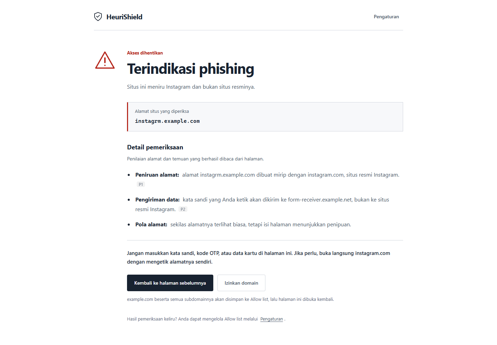

# HeuriShield

**Extension browser untuk mendeteksi dan memblokir situs phishing secara real time**, gabungan model XGBoost dan *heuristic analysis* atas URL, isi halaman, dan identitas brand.


> Proyek skripsi: *Rancang Bangun Extension Browser HeuriShield Berbasis Heuristic Analysis untuk Deteksi dan Pemblokiran Situs Phishing secara Real Time*, oleh Umar Faruq Manek.

<p align="center">
  
  <br><sub>Halaman blokir pada uji lab: tiruan login Instagram di <code>instagrm.example.com</code> diblokir oleh rule P1 dan P2.</sub>
</p>

## Apa yang dideteksi

| Serangan | Contoh | Ditangani oleh |
|---|---|---|
| **Peniruan brand** | `instgram.com`, `paypal.login.com`, `t0kopedia.com` | Rule P1 |
| **Pencurian kredensial** | Form login yang mengirim kata sandi ke domain lain atau ke Telegram Bot API | Rule P2, P3 |
| **Unduhan berbahaya** | Domain baru yang menawarkan `.exe`, `.apk`, atau arsip `.zip`/`.iso` atas nama brand lain | Rule P4 |

Situs yang terindikasi phishing langsung dialihkan ke halaman blokir. Halaman itu menjelaskan alasannya dalam bahasa sehari-hari.

## Cara kerja

```text
URL dibuka
  ├─ Model URL (XGBoost, 20 fitur)                 → kelas URL: SAFE / DANGEROUS
  ├─ DOM Analyzer (form, kata sandi, unduhan)      ┐
  ├─ Brand Analyzer (identitas & domain resmi)     ├→ 19 parameter → rule P1–P4, L1–L2
  └─ Umur domain (RDAP/WHOIS) + akhiran file URL   ┘
                          ↓
                Decision policy → SAFE / DANGEROUS / LIMITED
```

### 1. Model URL

- **XGBoost URL20 v3:** 500 pohon, threshold 0,50, dievaluasi langsung di browser tanpa server ([`xgboost-engine.js`](extension/HeuriShield-URL20-XGBoost/src/model/xgboost-engine.js)).
- URL dinormalisasi dengan standar WHATWG sebelum fitur dihitung, sama seperti saat pelatihan.
- 20 fitur dihitung dari teks URL saja:
  `url_length`, `hostname_length`, `path_length`, `query_length`, `subdomain_count`, `path_depth`, `dot_count`, `hyphen_count`, `digit_ratio`, `special_char_count`, `has_at_symbol`, `has_ip_host`, `has_https_scheme`, `hostname_entropy`, `sensitive_token_count`, `url_entropy`, `path_hyphen_count`, `domain_label_length`, `hostname_longest_digit_run`, `hostname_sensitive_token_count`.
- Model hanya mengeluarkan **kelas**. Probabilitasnya tidak diteruskan ke rule.

### 2. Parameter heuristik

Ada 19 parameter, masing-masing bernilai `true`, `false`, atau `unknown` ([`parameters.js`](extension/HeuriShield-URL20-XGBoost/src/analyzer/rules/parameters.js)).

| Kelompok | Parameter |
|---|---|
| Brand (9) | `brand_in_title`, `brand_in_heading`, `brand_in_logo`, `claimed_brand`, `claimed_brand_status`, `verified_reference_domain`, `host_brand_claim`, `official_domain_match`, `brand_domain_mismatch` |
| DOM (8) | `has_password_field`, `has_sensitive_input`, `form_cross_domain`, `login_button_detected`, `login_redirect_detected`, `has_download_link`, `download_file_extensions`, `download_target_cross_domain` |
| Pendukung (2) | `domain_age_days`, `url_file_extension` |

Content script hanya membaca **metadata** halaman: jenis kolom, tujuan form, teks judul/logo, dan tautan unduhan. **Isi kolom yang diketik pengguna tidak pernah dibaca.**

### 3. Rule

Setiap rule adalah konjungsi logika tiga nilai, tanpa bobot atau skor ([`heuristic-rules.js`](extension/HeuriShield-URL20-XGBoost/src/analyzer/rules/heuristic-rules.js)). "Domain baru" berarti umurnya ≤ 365 hari.

| Rule | Arah | Kondisi |
|---|---|---|
| **P1** | phishing | Hostname memuat nama brand, tetapi domain resmi brand itu berbeda |
| **P2** | phishing | Halaman meminta kredensial, form dikirim ke domain lain, dan domain halaman bukan domain resmi brand |
| **P3** | phishing | Domain baru meminta kredensial atas nama brand lain |
| **P4** | phishing | Domain baru menawarkan file yang dapat dijalankan (exe, apk, msi, js, lnk, …) atau arsip pembawanya (zip, rar, iso, …) atas nama brand lain |
| **L1** | legitimate | Domain resmi brand yang tampil di halaman, berumur > 365 hari, dan tidak meminta data akun |
| **L2** | legitimate | Login di domain resmi brand, berumur > 365 hari, dan form tetap di domain yang sama |

### 4. Decision policy

Langkah diperiksa berurutan. Langkah pertama yang terpenuhi menentukan hasil ([`decision-policy.js`](extension/HeuriShield-URL20-XGBoost/src/analyzer/rules/decision-policy.js)).

1. Model URL tidak tersedia → **LIMITED**
2. Ada rule P yang terpenuhi → **DANGEROUS**
3. Ada rule L yang terpenuhi → **SAFE**
4. Model menilai DANGEROUS, tetapi halaman berada di domain resmi brand yang terverifikasi (HTTPS, tanpa konflik referensi, form tidak keluar domain) → **SAFE**
5. Model menilai DANGEROUS, tetapi URL editor Google Docs / tampilan berkas GitHub dinilai aman setelah parameter tampilannya dibuang → **SAFE**
6. Selain itu → mengikuti kelas model URL

Bukti brand dan DOM didahulukan. Model URL menjadi penentu terakhir.

## Hasil pengujian

### Model URL (split test internal, 59.286 URL, dipisah per domain)

| Akurasi | Presisi | Recall | Specificity | F1 |
|---:|---:|---:|---:|---:|
| 91,97% | 92,10% | 88,30% | 94,60% | 90,16% |

### Uji live: keputusan akhir extension (v0.7.0, 12 November 2026)

Setiap URL dibuka di browser Chromium sungguhan. Hanya URL yang berhasil dianalisis yang dihitung. Rincian per URL ada di [`hasil_pengujian/uji_live/`](hasil_pengujian/uji_live/).

| | Data uji | Benar | Akurasi |
|---|---:|---:|---:|
| Legitimate | 492 | 437 | 88,82% |
| Phishing | 158 | 123 | 77,85% |
| **Total** | **650** | **560** | **86,15%** |

Model URL saja mencapai 80,00% pada data yang sama. Rule brand/DOM menaikkannya menjadi 86,15%.

### Uji lab lokal (v0.7.1)

Halaman tiruan disajikan lewat HTTPS dengan hostname tiruan di komputer lokal. Pengiriman form dicegat, sehingga tidak ada kredensial yang diterima. Hasil dan screenshot ada di [`hasil_pengujian/lab_lokal/`](hasil_pengujian/lab_lokal/).

| Skenario | Hasil |
|---|---|
| Clone login (Instagram, Facebook, PayPal, Tokopedia, Shopee, Binance) | 13/13 diblokir |
| Penguatan (Telegram Bot API, arsip zip/iso/lnk, Google Forms, brand tanpa API) | 8/8 sesuai harapan |
| Unduhan berbahaya (exe, apk, URL .exe, domain resmi pembanding) | 9/9 sesuai harapan |

### White box

20 kelompok / 60 variasi, semua lulus. Lihat [`docs/PENGUJIAN.md`](docs/PENGUJIAN.md).

## Memasang extension

1. Unduh atau clone repositori ini.
2. Buka `chrome://extensions` (Chrome) atau `edge://extensions` (Edge).
3. Aktifkan **Developer mode**.
4. Pilih **Load unpacked**, lalu pilih folder `extension/HeuriShield-URL20-XGBoost`.
5. Pastikan nama yang muncul **HeuriShield URL20 XGBoost v3**, versi **0.7.1**.

## Menjalankan tes

Butuh Node.js 22 atau lebih baru, tanpa instalasi pustaka tambahan.

```bash
npm test
```

Rincian semua tes ada di [`docs/PENGUJIAN.md`](docs/PENGUJIAN.md).

## Struktur repositori

```text
extension/HeuriShield-URL20-XGBoost/   Extension siap dimuat (Load unpacked)
  src/analyzer/                         URL, DOM, brand, umur domain, rule, decision policy
  src/background/                       Service worker: koordinasi analisis dan pemblokiran
  src/content/                          Pembaca DOM dan panel di halaman
  src/model/                            Model XGBoost (JSON) dan referensi suffix
  src/warning/, options/, history/      Halaman blokir, pengaturan, riwayat
model/                                  Model v3 hasil pelatihan Python (.joblib, .json) + hash
data/
  dataset_url20_training.csv.gz         Dataset pelatihan dan pengujian model (678.115 URL)
  brand_registry_source/                Sumber registri brand (CC BY-NC 4.0)
tests/                                  Tes white box, registri, dan URL platform
tools/                                  Pembangun registri brand, skrip Windows
hasil_pengujian/                        Bukti uji: white box, uji live, lab lokal, registri
docs/                                   Cara pengujian, registri brand, catatan perbaikan v0.7.1
```

## Dataset

`data/dataset_url20_training.csv.gz` berisi 678.115 URL beserta label, 20 fitur, dan kolom `split`. Pemisahan dilakukan **per domain**, sehingga domain yang sama tidak muncul di train dan test sekaligus.

| Split | Legitimate | Phishing | Total |
|---|---:|---:|---:|
| train | 351.933 | 260.780 | 612.713 |
| test | 34.596 | 24.690 | 59.286 |
| supplement_test | 1.679 | 4.437 | 6.116 |

Sumber data:
- **PhreshPhish** (611.244 URL), lisensi CC BY 4.0, khusus untuk riset anti-phishing ([arXiv:2507.10854](https://arxiv.org/abs/2507.10854));
- dua dataset pelengkap (49.733 dan 17.138 URL). Kolom `source` mencatat asal tiap baris.

Lingkungan untuk membuka `model/xgboost_url20_v3.joblib`: Python dengan `xgboost==3.4.1`, `scikit-learn==1.7.0`, dan `joblib==1.5.2`.

Catatan: untuk sekitar 7,5% baris, kolom `url_length` dan `url_entropy` di CSV dihitung sebelum normalisasi WHATWG (selisih satu karakter, yaitu garis miring di akhir). Extension selalu menormalisasi URL sebelum menghitung fitur.

## Privasi

Extension memerlukan internet untuk dua hal:

| Keperluan | Layanan | Data yang dikirim |
|---|---|---|
| Identitas brand | Clearbit Autocomplete, Brandfetch, API Brand-Domain HeuriShield | Kata dari judul/hostname halaman dan domain yang dikunjungi |
| Umur domain | Server RDAP resmi (via IANA), lalu tiga layanan WHOIS cadangan | Domain yang dikunjungi |

Karena itu, **domain setiap halaman yang dianalisis diketahui oleh layanan-layanan tersebut**. Isi kolom form dan cookie tidak dikirim. URL yang disimpan secara lokal dibersihkan dari token, sesi, dan parameter autentikasi.

## Keterbatasan

- **Domain lama yang dibobol** (umur > 365 hari, nama tidak meniru brand) tidak ditangani rule P. Keputusannya bergantung pada model URL.
- **Umur domain tidak tersedia** untuk sebagian TLD (mis. `.jp`, `.de`, `.ac.uk`). Akibatnya P3, P4, L1, dan L2 tidak dapat diterapkan, dan keputusan kembali ke model URL.
- **Identitas brand** bergantung pada layanan pencarian eksternal dan registri lokal: 31 brand kurasi ditambah 10.000 kandidat dari direktori perusahaan yang tidak diverifikasi manual ([`docs/REGISTRI_BRAND.md`](docs/REGISTRI_BRAND.md)).
- **Pemeriksaan unduhan** hanya membaca tautan dan akhiran nama file. Isi file tidak dipindai.
- **Analisis berjalan setelah halaman selesai dimuat**, lalu tab dialihkan ke halaman blokir. Permintaan ke situs tidak dicegat sebelum dikirim.
- **Bias dataset:** data legitimate didominasi situs populer berbahasa Inggris, sehingga situs sah dengan TLD negara atau TLD murah kurang terwakili.
- Ada satu pengecualian khusus situs ([`login-form-destination.js`](extension/HeuriShield-URL20-XGBoost/src/analyzer/dom/login-form-destination.js)): tujuan form login `portal.merdekasiber.com` dibaca dari skrip yang sudah ditinjau dan dipin dengan hash SHA-256.

Ini prototipe penelitian. Jangan jadikan satu-satunya perlindungan terhadap phishing.

## Riwayat versi

- **0.7.1 (versi ini):** memperbaiki tiga bug penilaian brand dari uji live v0.7.0 ([`docs/PERBAIKAN_v0.7.1.md`](docs/PERBAIKAN_v0.7.1.md)), lalu memperluas registri brand. Model, rule, dan decision policy sama dengan 0.7.0.
- **0.7.0:** model v3 (normalisasi WHATWG), rule P1–P4/L1–L2 menggantikan R01–R19. Versi ini yang dipakai pada uji live 12 November 2026.

## Lisensi

- **Kode:** MIT, lihat [`LICENSE`](LICENSE).
- **Data registri brand** (`data/brand_registry_source/`, `brand-registry-imported.js`): CC BY-NC 4.0, © Fliar BI.
- **Komponen pihak ketiga** (tldts, Public Suffix List, daftar TLD IANA, PhreshPhish): lihat [`THIRD_PARTY_NOTICES.md`](THIRD_PARTY_NOTICES.md).
